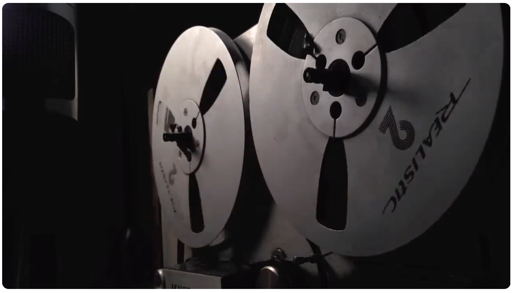

I grew up playing music every day, writing songs and constantly thinking about my bands. Some day I'll upload music from my high school reggae band, my glam rock band from College, and the bedroom rock album I made in my 20's. Something, someting hot on 78. When I play music now it is generally with Shawn Hansen. ​

Shawn and I first played music together in the pop group Monogram in a fit of pre-9/11 optimism. Monogram started off playing songs about the seven wonders of the world with a seven wonders theme added in to make eight songs. The band was hot, but few recordings were made. One by one the group peeled off, took a sabbatical, started a new band or left town.

Eventually, Shawn and I playing got together again on Kansas City's Westside while we all white-knuckled through the hangover from the Great Financial Crisis. Maybe because we were thinking a lot about food at the time, maybe because there were only two of us, we decided to call ourselves a pairing instead of a duo and the name has stuck. Over the past decade or so Shawn has a released half-dozen or so recordings of our playing. He does most of the work cleaning up our sessions, selecting the parts, packaging and sharing them online. All the while Shawn has been prolifically collaborating and releasing his own music, I highly recommend his albums [Frenzy](https://shawnedwardhansen.bandcamp.com/album/frenzy), [Radio Badlands](https://shawnedwardhansen.bandcamp.com/album/radio-badlands), and [Want Cry Love](https://shawnedwardhansen.bandcamp.com/album/want-cry-love) to get a sense of his range.

::: {style="text-align: center;"}
[{width="500"}](https://shawnedwardhansen.bandcamp.com/album/curling-when-the-crisis-hits)
:::

​​I described this, our most recent release, to a friend as improvised microtonal music, though that may not be strictly speaking accurate. I'm playing a nice instrument here, borrowed from Johnny Hammill with one of his French bows alternating with a short bow made by Tatsuya Nakatani for bowing cymbals. I generally don't like the timbre of the bass when I bow it, nevertheless, I make a point of playing with a bow when I get the chance—hoping that through repetition I will improve. Listening back to these recordings I hear the an anxiety in my sound that is familiar and appropriate for these songs.

::: {style="text-align: center;"}

:::
