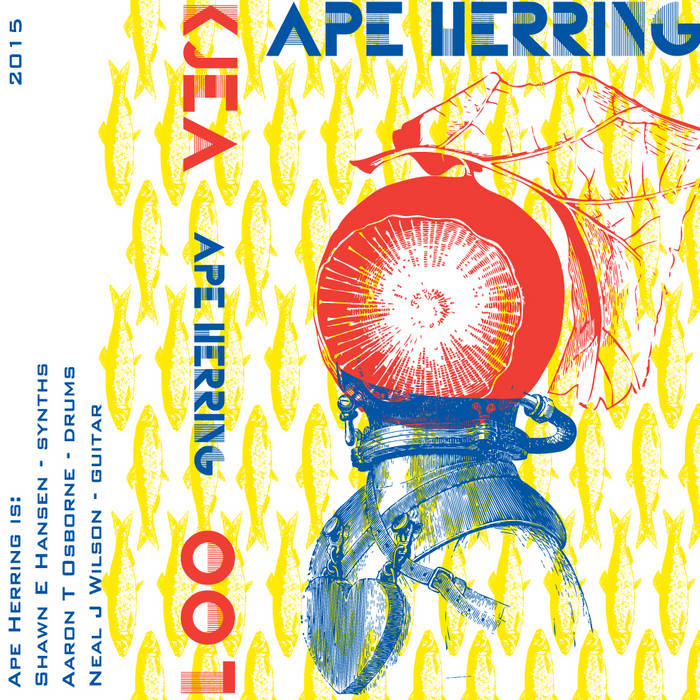
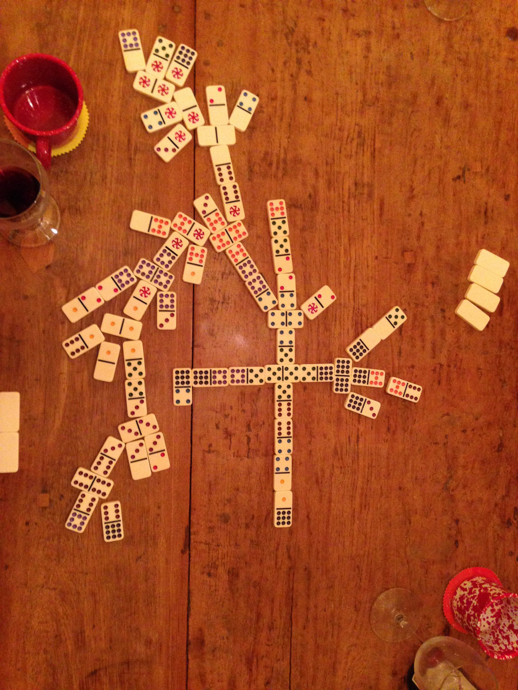
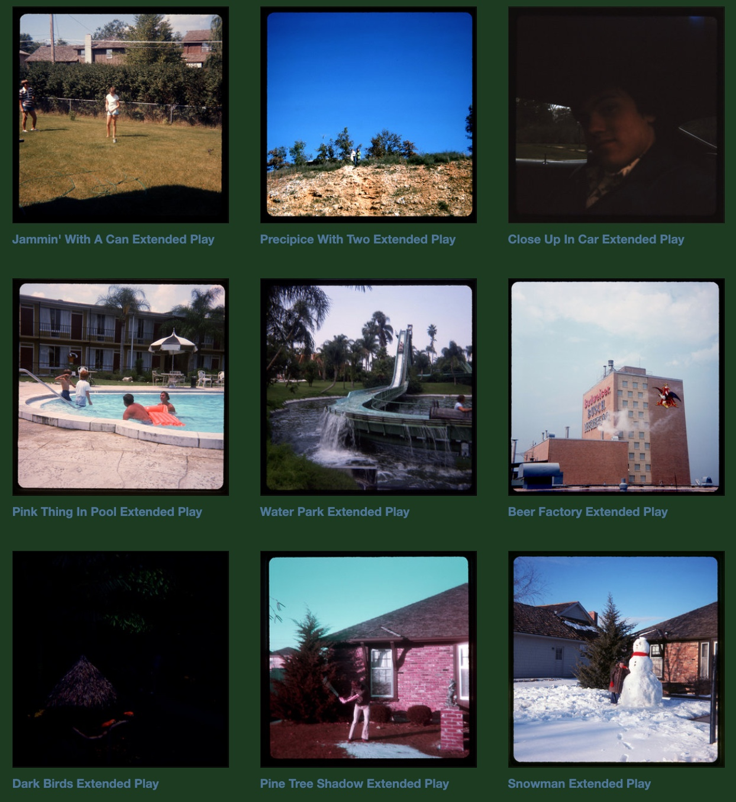

I grew up playing music every day, writing songs and constantly thinking about my bands. Some day I'll upload music from my high school reggae band, my glam rock band from College, and the bedroom rock album I made in my 20's. Something, someting hot on 78. When I play music now it is generally with Shawn Hansen. ​

Shawn and I first played music together in the pop group Monogram in a fit of pre-9/11 optimism. Monogram started off playing songs about the seven wonders of the world with a seven wonders theme added in to make eight songs. The band was hot, but few recordings were made. One by one the group peeled off, took a sabbatical, started a new band or left town.

Eventually, Shawn and I playing got together again on Kansas City's Westside while we all white-knuckled through the hangover from the Great Financial Crisis. Maybe because we were thinking a lot about food at the time, maybe because there were only two of us, we decided to call ourselves a pairing instead of a duo and the name has stuck. Over the past decade or so Shawn has a released half-dozen or so recordings of our playing. He does most of the work cleaning up our sessions, selecting the parts, packaging and sharing them online. All the while Shawn has been prolifically collaborating and releasing his own music, I highly recommend his albums [Frenzy](https://shawnedwardhansen.bandcamp.com/album/frenzy), [Radio Badlands](https://shawnedwardhansen.bandcamp.com/album/radio-badlands), and [Want Cry Love](https://shawnedwardhansen.bandcamp.com/album/want-cry-love) to get a sense of his range.

::: {style="text-align: center;"}
[{width="500"}](https://shawnedwardhansen.bandcamp.com/album/curling-when-the-crisis-hits)
:::

​​I described this, our most recent release, to a friend as improvised microtonal music, though that may not be strictly speaking accurate. I'm playing a nice instrument here, borrowed from Johnny Hammill with one of his French bows alternating with a short bow made by Tatsuya Nakatani for bowing cymbals. I generally don't like the timbre of the bass when I bow it, nevertheless, I make a point of playing with a bow when I get the chance—hoping that through repetition I will improve. Listening back to these recordings I hear the an anxiety in my sound that is familiar and appropriate for these songs.

::: {style="text-align: center;"}
[{width="500"}](https://www.youtube.com/watch?v=1xdTD3rzsig)
:::

There is a hermetic logic embedded in the harmonies here. We recorded track after track with Sam Hughes in his attic and I remember getting quite light headed trying to play the bass recorder. That was after we put down the initial bass or organ tracks. We brought Jolin in to play the two saxophone solos cold---plied him with booze and weed before setting him loose with no reference to any pitches, only the rhythm track and recorded what here did for this video. As an instantiation of either Kondratiev long waves or Ricardian corn models, I'm not sure it tracks, but it does work quite well as a composition.

::: {style="text-align: center;"}
[{width="500"}](https://shawnedwardhansen.bandcamp.com/album/blue-shed-vol-1)
:::

Recorded live in a work shed during a Kansas City rain storm. Shawn's idea then was that he could record whole suite of sessions in the blue shed, and this is just the first of many volumes. I'm playing the bass my great uncle built and Shawn is playing the OP-1. It is probably the best example of what we sound like when we are improvising together (rather than working out some concept, playing a composition or experimenting with instrumentation). Part of Shawn's KJEA series, and our most recent recording to be issued in a physical format.

::: {style="text-align: center;"}
[{width="500"}](https://shawnedwardhansen.bandcamp.com/album/ape-herring)
:::

Aaron Osborn is the reason Shawn and I started playing music together. Aaron was the first bass player for Monogram, but his playing style wasn't a good match for that music. Aaron recommended me  for the band and now we are here. This first of the KJEA series was selected from many hours of rehearsal recordings and combined by Shawn into two sides of seamless musical flow. When Aaron joined us we were no longer a pairing, different but the same. Before this group went on hiatus we wrote and recorded a holiday meal themed suite. Someday, perhaps that too will meet the public's ears.  

::: {style="text-align: center;"}
[{width="500"}](https://shawnedwardhansen.bandcamp.com/album/a-pairing-two-part-drone-canon)
:::

The 127.5 minute composition is based on the cycle of day — date  combinations inspired by a 19th century magazine illustration. This recording was (I think) done by Ashley Miller with the AC off on a very hot summer day in 2013 as part of Doug Aiken's Station to Station exhibition. People from outside of KC were always trying to 'bring culture to Kansas City'. It's insulting. When performing live we played it at more or less double time in recognition of how demanding an over two hour piece of music is.

::: {style="text-align: center;"}
[{width="500"}](https://apairing.bandcamp.com/)
:::

We improvised a set of drones, ostinatos, rhythm machine duets which we then paired and sometimes tripled together. I think this was the first set of our recordings we made available. Our original idea was to release these as a set of 12 lps so people could make their own pairings. Years after we posted these nine Shawn released another set of double pairings. There are still a few recordings from these sessions yet to be paired and released. Conceptually, we talked about a fourth type of pairing expressing randomness in the way the other pairings are drones, ostinatos, and rhythm machines. Because of that, and the recorded but unreleased pairings, this project is ongoing.

​