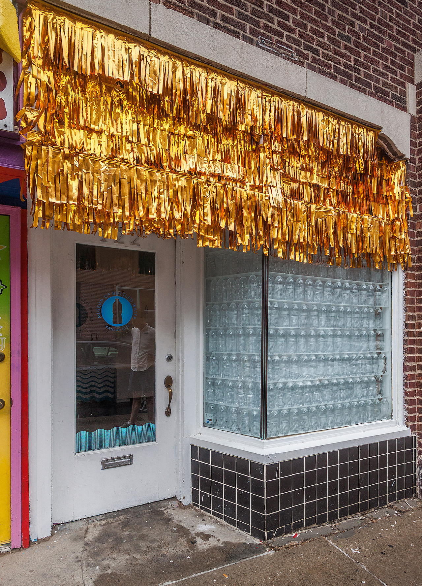
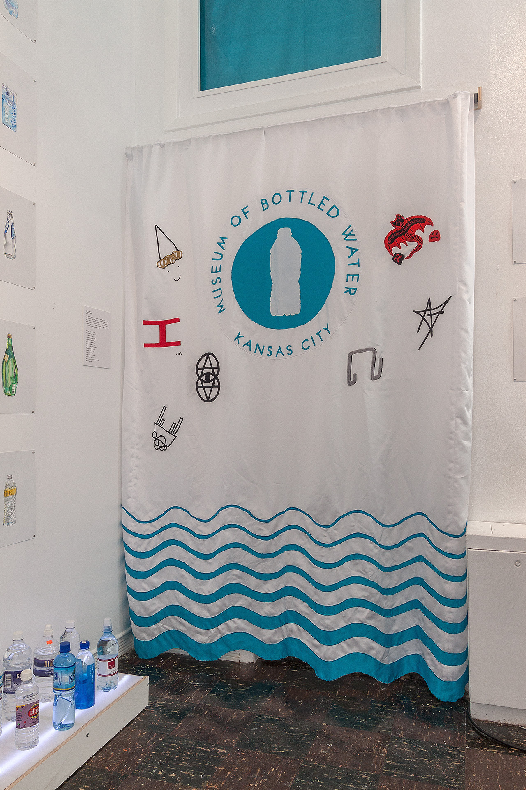

The Museum of Bottled Water was founded on the idea that bottled water is one of the objects that define our age. To understand bottled water as an object is to see industrial production, globalization, and marketing instantiated in an anodyne commodity. According to [Reuters](https://www.reuters.com/graphics/ENVIRONMENT-PLASTIC/0100B275155/), in 2018 almost one million plastic water bottles were purchased every minute, 1.3 billion plastic bottles purchased every day. The process for blowing polyethylene terephthalate pellets into bottles was first developed in 1973 by Nathaniel Wyeth, brother of the artist Andrew Wyeth.

Containerized shipping: Perrier -important as a model of production globalization The story of Perrier's creation of the bottled water industry deserves its own essay.

That should remind us that the bottled water industry is actually quite old. If we are willing to slightly shift our focus from bottled water to packaged water a slightly different understanding opens up. In the current moment cartons, cans, bags, etc. If we look to the past the story of human development can be told through the technologies used

In our contemporary moment of rapine with the planet that sustains us, some people come to the museum of bottled water wanting to know

Blair Schulman wrote an article about the last public installation of [the museum for Hyperallergic.](https://hyperallergic.com/an-artist-run-bottled-water-museum-springs-up-in-kansas-city/)

{fig-align="left"} The Museum of Bottled Water was a collaborative effort. Tim Harte created the soundtrack for the museum. Elvis Achelpohl was the chief architect. Seth Johnson did the graphic design. Hadley Clark made the docent's uniform. EG Schempf documented the installations. Charlie Miley illustrated some of the collection. Lacey Wozny assisted with project management. Adam Crowley assisted with preparations work. Elliot Oliver consulted about insurance. I tried to celebrate the collaborative reality of the project by hanging a banner with the museum's logo surrounded by the logos of the team. Amy Frogpockets emborydered the banner. {fig-align="left"} The Museum is currently on hiatus and our collection in long-term storage as we contemplate the next iteration of the project.

That said, new items are occasionally added to the collection.
